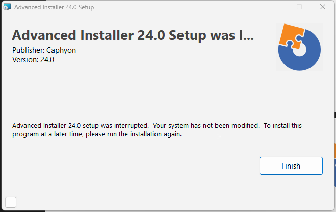
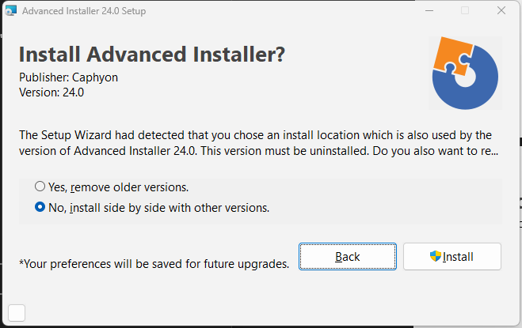

# advanced-installer-mcp

An [MCP](https://modelcontextprotocol.io) server that helps AI coding agents work with
[Advanced Installer](https://www.advancedinstaller.com) projects: lint and render setup dialogs, run builds and
return structured results.

Status: early development. See [ADR 0001](docs/adr/0001-tech-stack-and-v0.1-scope.md) for the planned v0.1 scope.

## Requirements

- Windows
- .NET 10 SDK
- Advanced Installer (for the `build` tool)

## Build and register with Claude Code

Publish to a folder of its own and point the client at that executable:

```
dotnet publish src/AdvancedInstallerMcp -c Release -o "%LOCALAPPDATA%\advinst-mcp"
claude mcp add advinst -- "%LOCALAPPDATA%\advinst-mcp\AdvancedInstallerMcp.exe"
```

- Not `bin\Debug`: the client keeps the server running for the whole session, which locks the file and breaks the
  next `dotnet build`. Publish again (with the session closed) to update the registered server.
- Not `dotnet run`: build output on stdout would corrupt the stdio protocol.

## Tools

| Tool | What it does |
|---|---|
| `lint_dialog` | Reads the setup dialogs of a built `.msi` (no install) and reports labels of Text, CheckBox and PushButton controls that do not fit, measured with the package's own font as Windows draws it, at 100, 125 and 150 % scaling; each finding gives the smallest size in installer units that fits. Also reports controls cut off by the dialog's edge, controls whose visible content overlaps, a tab order that is not a closed cycle or misses controls, and packages whose embedded UI replaces these dialogs. Pass `dialog` to check one dialog. |
| `ping` | Checks that the server runs. |

How the measurement works and where its numbers come from: [ADR 0003](docs/adr/0003-installer-units-and-text-measurement.md)
and the [control calibration](docs/research/2026-10-11-control-calibration.md). The layout rules and why they compare
what controls paint instead of their rectangles: [ADR 0005](docs/adr/0005-dialog-layout-rules.md).

## Example: hidden clipped labels in a fallback UI

The setup package of Advanced Installer 24.0 has two UIs. Normally it shows its own embedded UI (`MsiEmbeddedUI`).
It also carries classic Windows Installer dialogs, which msiexec draws only when the embedded UI does not run. Users
rarely see those fallback dialogs, so a clipped label there is easy to miss in manual testing.

`lint_dialog` checked the 21 fallback dialogs without installing anything and reported two clipped labels. Both show
up exactly as predicted when msiexec draws the dialogs at 100 % scaling:

| Control | `lint_dialog` | msiexec |
|---|---|---|
| `UserExit` / `ProductNameTitle` | Segoe UI 20 pt bold wraps to 2 lines in a 1-line area; Windows shows 1 line ending in "...". Fits at height 56 (now 32). |  |
| `UpgradeDlg` / `QuestionReplace` | Wraps to 3 lines, 60 px, in a 59 px area; Windows shows 2 lines ending in "...". Fits at height 45 (now 44). |  |

In the same dialogs, the labels that fit (the `Question` text, "Install Advanced Installer?") were not reported. The
full report also has the `embedded-ui` warning described below and two overlap warnings for controls that a condition
shows.

We did not check how the embedded UI shows these texts. To capture the fallback dialogs we ran a copy of the package
with the embedded UI, custom actions and install sequence removed, so that msiexec showed only these two dialogs and
installed nothing. Packages without an embedded UI show their classic dialogs to every user, so there a clipped label
is seen by everyone who reaches that dialog.

## Tests

```
dotnet test
```

The tests build small MSI packages with `msi.dll` itself, so they do not need Advanced Installer.

## License

MIT. This project is not affiliated with Caphyon or Advanced Installer.
