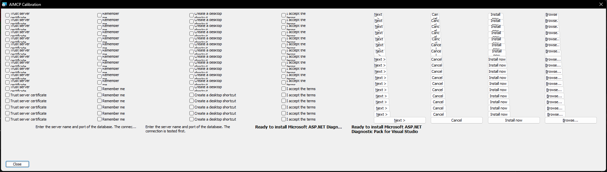

# Control calibration against msiexec (2026-10-11)

ADR 0003 leaves the check box and push button margins to be "calibrated once against a real screenshot". This is
that calibration, plus a visual check of the Text control rule.

## Setup

- Windows 11, 96 DPI (100 %), default theme. Font: Tahoma 8 pt (`DefaultUIFont`).
- `tools/calibration/calibrate-controls.ps1` builds a throw-away MSI whose only dialog shows four check box labels
  and four push button labels, each in 17 controls of increasing width (1 installer unit apart) plus a wide
  reference. msiexec opens it (the UI sequence shows the dialog; there is no execute sequence, nothing is
  installed), the script captures the dialog from the screen and compares the dark pixels of every control with its
  reference, cropped to their bounding box. Same pixels = the whole label shows.
- Text widths are plain `DrawText` widths, the same call as `TextMeasurer`.

## Result

| Control | Label | Text px | Narrowest width that shows it all | Width − text |
|---|---|---|---|---|
| CheckBox | Trust server certificate | 110 | 95 units = 126 px | 16 px |
| CheckBox | Remember me | 68 | 63 units = 84 px | 16 px |
| CheckBox | Create a desktop shortcut | 126 | 107 units = 142 px | 16 px |
| CheckBox | I accept the terms | 88 | 78 units = 104 px | 16 px |
| PushButton | &Next > | 34 | 30 units = 40 px | 6 px |
| PushButton | Cancel | 32 | 29 units = 38 px | 6 px |
| PushButton | Install now | 52 | 44 units = 58 px | 6 px |
| PushButton | &Browse... | 47 | 40 units = 53 px | 6 px |

One unit narrower always cut the label. Units are 1.33 px apart, so a label pins the threshold exactly only when
the cut and the whole width are 1 px apart (two labels per type); the others leave a 2 px gap that agrees with the
same value. A check box needs its text width **+ 16 px**, a push button its text width **+ 6 px**. `DialogLinter.CheckBoxTextOffset`
and `PushButtonTextMargin` hold these values; at 120 and 144 DPI they are scaled linearly, which is not calibrated.

## What a label that does not fit looks like

- **CheckBox:** the label wraps at word boundaries inside the width left of the box, and the lines are centred
  vertically, so in a 12-unit check box a two-line label shows the bottom of the first line and the top of the
  second. Not "...". So a check box is checked like wrapping text: wrapped height in (width − 16 px) ≤ height.
- **PushButton:** the label wraps too (visible in the narrow buttons) and gets cut the same way. `lint_dialog` still
  checks buttons as one line: in a standard 17-unit button a second line (26 px) never fits in 23 px, and the
  vertical margins needed for a deliberately tall two-line button are not calibrated. Such a button is reported
  as clipped (known limitation).
- **Text:** shows the lines that fit and ends the last visible one with "...". The ADR 0003 hint (two lines in
  Tahoma 8) shows as one line ending in "The connec..." at 230×18 and as two full lines at 230×20; a 9 pt bold
  "Ready to install <long product name>" title shows one line with "..." at 200×15 and two lines at 200×22. All four
  match `lint_dialog`'s verdict.

## Capture pitfall

`PrintWindow` (with `PW_RENDERFULLCONTENT`) returned some controls unpainted: in one capture three of the four Text
controls and a whole column of buttons were missing. The script captures from the screen after bringing the dialog
to the front. A repeat run with screen capture gave the same thresholds as the first run.
